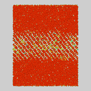
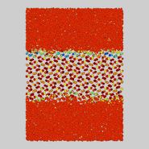
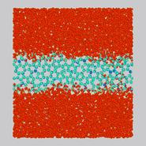
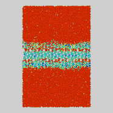
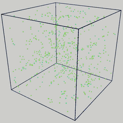
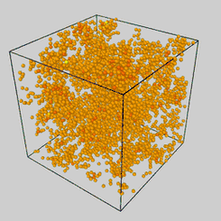
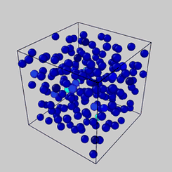

# **ice-motifs**

## Mapping motif in disorder-order transitions: learning the structural motifs of supercooled liquids and crystals

---

### Trajectories coloured by motif labels determined by vector-quantization of the VAE's latent embeddings.

<table>
<tr>
<td align="left"><br><sub><b>heterogeneous-1</b></sub></td>
<td align="left"><br><sub><b>heterogeneous-2</b></sub></td>
<td align="left"><br><sub><b>heterogeneous-3</b></sub></td>
<!--<td align="left"><br><sub><b>heterogeneous-4</b><sub></td>-->
</tr>
<tr>

</tr>
<tr>
<td align="left"><br><sub><b>nucleation-slow</b></sub></td>
<td align="left"><br><sub><b>silicon</b></sub></td>
<td align="left"><br><sub><b>ldl-hdl</b></sub></td>
</tr>
<tr>

</tr>
</table>

---

## Install Packages

```bash
git clone https://github.com/yifei-1021/ice-motifs.git && cd icemotifs
pip install .
python -m pytest tools/            #  no trajectory needed
```

`requirements.txt` contains the essential packages `dscribe`, `ase`, and `torch` 2.6.

## Reproducing Analyses

Each folder in `examples/` is one dataset from the paper, containing a subset of ten frames
of its trajectory so you can run it immediately:

```bash
cd examples/ldl-hdl                       # the cheapest folder: 192 atoms/frame
export STRIDE=1                           # the sample is ALREADY strided
python scripts/01_featurize.py sample-data/192-235.0-3200-hi-water.sample.extxyz
python scripts/02_train_vae.py && python scripts/03_project.py
python scripts/04_cluster.py  && python scripts/05_relabel.py
python scripts/06_analyze.py  && python scripts/07_figures.py
```

Run the notebooks to reproduce our analyses based on our stored results:

```bash
python tools/run-example-notebooks.py --runs-root /path/to/the/runs/tree
```

See our trajectory dataset from the deposit: (<https://doi.org/10.5281/zenodo.20483265>).

## Run it on your own trajectory

```bash
# 0. ALWAYS measure the first-neighbour distance first
icemotifs check --system water-mw --dump /path/to/your.lammpstrj

# 1. add your system to icemotifs/systems.py  (one dataclass entry)
icemotifs systems                  # lists what is registered

# 2. run stages 1-5
icemotifs all --system my-system --input /path/to/your.lammpstrj \
              --kind dump --out runs/my-system --stride 20
```

`--kind` takes `dump` (LAMMPS text), `extxyz` (one multi-frame file) or
`filelist` (a listing of per-frame extxyz) — one code path, so one set of cutoff
decisions. You get `motifs/clustering.json`, `labels.npy`, the 2-D embedding and
the fitted UMAP reducer.

---

## Analysis pipeline

The analysis pipeline has seven stages, each a separate command and module.

| | stage | reads | writes |
|---|---|---|---|
| 1 | `featurize` | trajectory | Steinhardt + SOAP per atom |
| 2 | `train` | features | VAE weights |
| 3 | `encode` | features + VAE | latent `Z.npy` |
| 4 | `project` | `Z.npy` | 2-D `embedding.npy` + the frozen reducer |
| 5 | `cluster` | embedding | `labels.npy`, `clustering.json` |
| 6 | `relabel` | embedding + labels | `relabel.csv` — a rank for colouring |
| 7 | `frames` | trajectory + labels | extxyz for a renderer |


## Design choices for unsupervised learning

- **Clustering is two-stage.** HDBSCAN finds the clusters; k-means tiles the
  intermediate regions.
- **Other projection methods are possible.** We apply UMAP projection here, but other projection methods such as PCA/kPCA can be applied too.

## Three parameters that can be tuned

1. **`d_nn` sets every cutoff.** The SOAP radius, all three Steinhardt shells
   and the ring network are multiples of the first-neighbour distance.
2. **`lambda_pred` decides what a density or energy correlation means.** A
   regression head predicts per-atom Voronoi volume and energy, weighted by
   `lambda_pred` (default **0.1**).
3. **Quote the HDBSCAN cluster count and the intermediate fraction, never the
   motif total.** The total adds `n_kmeans` k-means tiles to a measured number,
   and `n_kmeans` is yours to set; on our runs those tiles hold 11–38 % of the
   atoms. (`clustering.json` still spells the two `n_density_maxima` and
   `outlier_fraction`.)

---

## Subfolders

| | |
|---|---|
| `icemotifs/` | the main code library with scripts for the seven stages in the pipeline — [`icemotifs/README.md`](icemotifs/README.md) |
| `examples/` | seven datasets (per folder) with sample data — [`examples/README.md`](examples/README.md) |
| `tools/` | the processing and maintenance scripts — [`tools/README.md`](tools/README.md) |


## Citations

**Working Paper.** Yue, Xing, Mohammed, Jiang & Loh, *Mapping Hierarchical Motifs in
disorder-order transitions: learning structural motifs in supercooled liquids
and crystals*, ChemRxiv (preprint), 2026.
<https://chemrxiv.org/doi/full/10.26434/chemrxiv.15004179>

**Source data.** The trajectories and polymorph datasets are a separate deposit
with its own DOI: <https://doi.org/10.5281/zenodo.23488444>. 

```bibtex
@article{yue2026motifs,
  title   = {Mapping Hierarchical Motifs in disorder-order transitions:
             learning structural motifs in supercooled liquids and crystals},
  author  = {Yue, Yifei and Xing, Lechun and Mohammed, Saad Aldin and
             Jiang, Jianwen and Loh, N. Duane},
  journal = {ChemRxiv (preprint)},
  year    = {2026},
  doi     = {10.26434/chemrxiv.15004179}
}
```

Code authors: Yifei Yue (yifeiyue@u.nus.edu); Lechun Xing; N. Duane Loh (duaneloh@nus.edu.sg).

## Licence

MIT. Copyright (c) 2026 Yifei Yue, Lechun Xing, Saad Aldin Mohammed,
Jianwen Jiang, N. Duane Loh.


